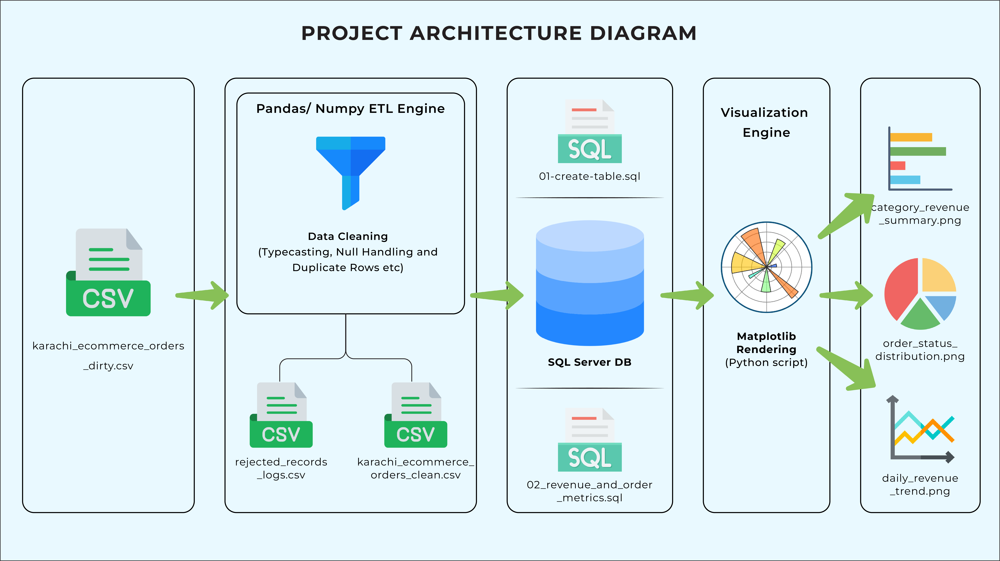
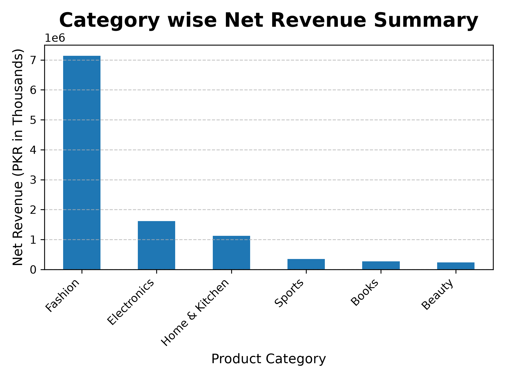
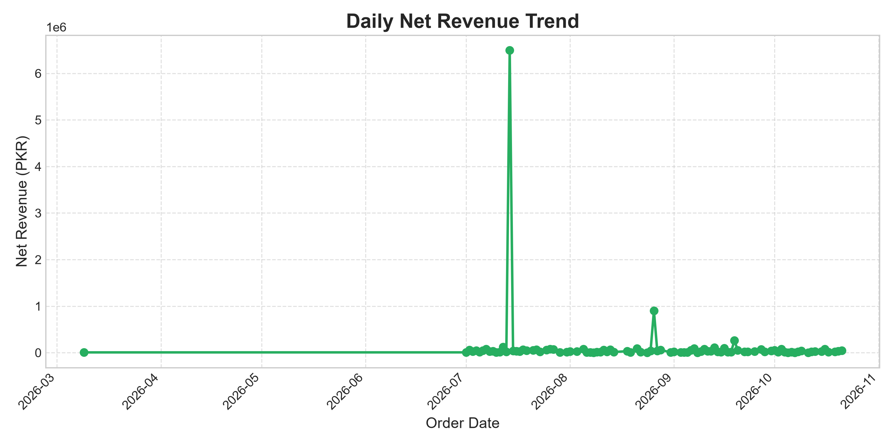
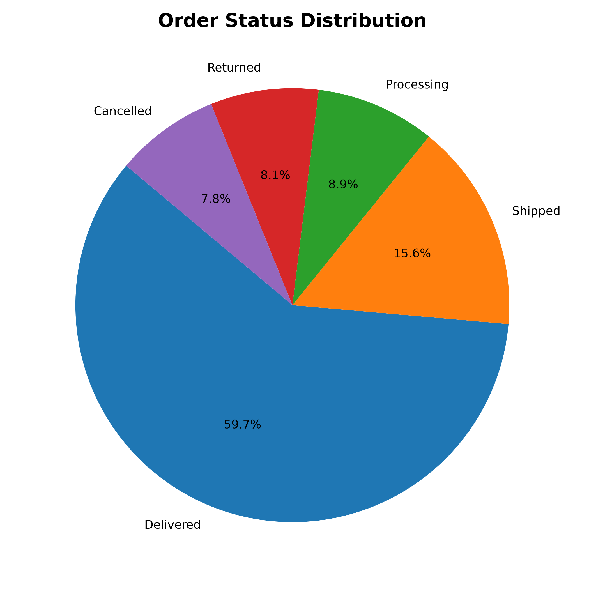

# Karachi E-Commerce ETL & Reporting Pipeline

A Python-based ETL pipeline that processes raw e-commerce transaction data, performs data cleaning and quality checks, separates rejected records, loads cleaned data into Microsoft SQL Server, and generates business-focused visual reports using Matplotlib.

The project demonstrates practical data engineering concepts, including data transformation, data quality handling, relational database loading, SQL analytics, and automated reporting.

---

## Project Architecture



The pipeline follows an Extract, Transform, Load (ETL) workflow, followed by SQL-based analysis and data visualization.

### Workflow Overview

1. **Extract:** Read raw e-commerce transaction data from a CSV file using Pandas.
2. **Transform:** Standardize text, normalize date formats, convert data types, handle missing values, identify duplicates, and apply data quality rules.
3. **Separate Rejected Records:** Save records that fail applicable validation rules into a dedicated CSV file with an associated error reason.
4. **Load:** Prepare cleaned records for database insertion and load them into Microsoft SQL Server using Python and parameterized SQL queries.
5. **Analyze:** Execute SQL queries to investigate revenue and order-related metrics.
6. **Visualize:** Generate charts with Matplotlib and save them as PNG files for further analysis and presentation.

---

## Project Objectives

The primary objectives of this project are to:

- Build a complete, locally executable ETL workflow using Python.
- Process raw e-commerce data containing data quality issues.
- Standardize inconsistent text values and date formats.
- Convert columns into appropriate data types.
- Handle missing and invalid values using defined rules.
- Recover selected missing values using business assumptions.
- Separate rejected records for traceability.
- Store cleaned transactional data in Microsoft SQL Server.
- Use SQL to analyze revenue and order-related metrics.
- Generate visual reports using Matplotlib.
- Organize the implementation into reusable Python modules.

---

## Technology Stack

| Technology | Purpose |
|---|---|
| Python | ETL orchestration and data processing |
| Pandas | CSV processing, data cleaning, transformations, and aggregation |
| NumPy | Supporting data-processing operations |
| Microsoft SQL Server | Relational database storage |
| SQL | Table creation and business-oriented analytical queries |
| pyodbc | Connecting Python to SQL Server |
| Matplotlib | Generating data visualizations |
| Jupyter Notebook | Experimentation and prototyping |

---

## Repository Structure

```text
ETL-Project/
│
├── 01-data/
│   ├── 01-raw/
│   │   └── karachi_ecommerce_orders_dirty.csv
│   │
│   ├── 02-processed/
│   │   └── karachi_ecommerce_orders_clean.csv
│   │
│   └── 03-rejected/
│       └── rejected_records_logs.csv
│
├── 02-scripts/
│   ├── __pycache__/
│   ├── etl_pipeline.py
│   ├── generate_reports.py
│   ├── load_sql.py
│   └── transform_clean.py
│
├── 03-sql/
│   ├── 01-create-table.sql
│   └── 02_revenue_and_order_metrics.sql
│
├── 04-notebooks/
│   ├── etl_pipeline.ipynb
│   └── reports_prototyping.ipynb
│
├── 05-images/
│   ├── architect_diagram.png
│   ├── category_revenue_summary.png
│   ├── daily_revenue_trend.png
│   └── order_status_distribution.png
│
└── README.md
```

### Key Components

| Component | Responsibility |
|---|---|
| `transform_clean.py` | Data cleaning and transformation logic |
| `load_sql.py` | SQL Server connection and data loading |
| `etl_pipeline.py` | Coordinates the ETL workflow |
| `generate_reports.py` | Generates and saves visual reports |
| `01-create-table.sql` | Defines the destination table schema and constraints |
| `02_revenue_and_order_metrics.sql` | Contains SQL queries for revenue and order analysis |
| `etl_pipeline.ipynb` | Notebook-based ETL development and experimentation |
| `reports_prototyping.ipynb` | Visualization prototyping |

`__pycache__/` is automatically generated by Python and is not a source-code component.

---

## Data Sources and Outputs

### 1. Raw Data

**File:** `01-data/01-raw/karachi_ecommerce_orders_dirty.csv`

Contains the original e-commerce transaction dataset used as the pipeline's input.

The raw file is kept separate from the processed output so that transformations do not overwrite the original source data.

### 2. Cleaned Data

**File:** `01-data/02-processed/karachi_ecommerce_orders_clean.csv`

Contains the records retained after the defined data-cleaning and validation steps.

This dataset is also used as the input for SQL Server loading and downstream analysis.

### 3. Rejected Records

**File:** `01-data/03-rejected/rejected_records_logs.csv`

Contains records excluded by applicable validation rules, together with an `error_reason` column describing the associated issue.

The rejection process covers applicable conditions such as missing or invalid dates, invalid quantities, invalid prices, invalid discounts, unresolved missing values, and duplicate order-line identifiers.

Exact duplicate rows are removed during the initial cleaning step and are not necessarily included in the rejection log.

---

## Data Cleaning and Transformation

The transformation stage uses Pandas to standardize the input dataset and apply data quality rules before database loading.

### 1. Duplicate Handling

- Identify and remove exact duplicate rows.
- Detect duplicate `order_line_id` values.
- Retain the first occurrence of a duplicated order-line identifier according to the implemented rule.
- Record duplicate order-line conflicts in the rejection dataset.

### 2. Text Standardization

Selected text columns are standardized by trimming surrounding whitespace and applying title-case formatting.

The selected columns include:

- `city`
- `product_category`
- `product_name`
- `payment_method`
- `order_status`
- `sales_channel`

### 3. Date Standardization

The `order_date` column is processed to handle multiple date representations.

The transformation attempts to parse supported formats and standardizes successfully parsed dates into a consistent `YYYY-MM-DD` representation.

Records with unresolved dates are separated according to the pipeline's validation rules.

### 4. Quantity Validation

The `quantity` column is converted to a numeric data type.

The implemented transformation normalizes negative quantities and identifies zero or missing quantities for rejection according to the project's rules.

### 5. Unit Price Validation

The `unit_price_pkr` column is converted to a numeric data type.

Negative values are normalized according to the implemented rule, while zero and missing unit prices are identified and excluded from the cleaned dataset.

### 6. Discount Validation

The `discount_pct` column is converted to a numeric data type.

The pipeline applies the implemented normalization rule and retains discount values within the accepted range of `0.0` to `1.0`, representing 0% to 100%.

Missing or out-of-range values are handled according to the validation rules.

### 7. Delivery Days

The `delivery_days` column is converted to a numeric representation and then to Pandas' nullable integer type, `Int64`.

The implemented transformation normalizes negative values.

### 8. Missing-Value Recovery

Selected missing values are recovered using related records where the project's business assumptions support doing so.

Examples include:

- Recovering `customer_id` from other line items belonging to the same `order_id`.
- Recovering `city` and `payment_method` from related records within the same order.
- Recovering `product_category` using other records with the same product name.

Values that remain unresolved are handled according to the applicable rejection rules.

### 9. Preparing Data for SQL Server

Before database insertion, missing Pandas values are converted into Python `None` values where appropriate, allowing the database driver to represent them as SQL `NULL`.

The transformed records are then prepared for parameterized insertion into SQL Server.

---

## SQL Server Integration

The project uses Microsoft SQL Server as its relational database.

### Database Setup

The destination table is defined in:

`03-sql/01-create-table.sql`

The table schema includes the dataset's relevant fields and database constraints, with `order_line_id` designated as the primary key.

Python connects to SQL Server through `pyodbc`.

The data-loading component uses parameterized SQL queries to insert records, rather than constructing SQL statements by directly concatenating individual data values.

### Data Loading Workflow

1. Prepare the cleaned DataFrame for database insertion.
2. Convert records into a format accepted by the database driver.
3. Establish a connection to SQL Server.
4. Execute the parameterized insertion query.
5. Commit the transaction after the insertion operation.

The SQL schema and the Python loading logic should remain consistent when the project is configured on another machine.

---

## SQL Analysis

**File:** `03-sql/02_revenue_and_order_metrics.sql`

This file contains SQL queries for investigating revenue and order-related metrics.

The analytical layer allows the cleaned transactional data to be queried in a relational database rather than relying exclusively on Python transformations.

The queries can be used to explore business performance and prepare data for further reporting.

---

## Data Visualization

The reporting component uses Matplotlib to generate static visual reports.

The generated images are saved in `05-images/`.

### 1. Category Revenue Summary

**File:** `category_revenue_summary.png`

A bar chart designed to compare revenue across product categories and identify categories contributing to sales performance.



### 2. Daily Revenue Trend

**File:** `daily_revenue_trend.png`

A line chart designed to show changes in daily revenue over time.



### 3. Order Status Distribution

**File:** `order_status_distribution.png`

A pie chart showing the distribution of orders across the available order statuses.



These visualizations provide a compact way to communicate the results of the data-processing and analysis workflow.

---

## How to Run the Project

The following steps describe how to configure and run the project on a local Windows environment.

### Prerequisites

Install or configure the following:

- Python
- Microsoft SQL Server
- SQL Server Management Studio (SSMS), or another SQL client
- A compatible Microsoft SQL Server ODBC driver
- Python packages used by the project

### Step 1: Clone the Repository

Replace the placeholder with the actual GitHub repository URL.

```bash
git clone <YOUR_REPOSITORY_URL>
cd ETL-Project
```

Alternatively, download the repository and open the `ETL-Project` directory in your IDE.

### Step 2: Create a Virtual Environment

```bash
python -m venv .venv
```

Activate it in Windows Command Prompt:

```bat
.venv\Scripts\activate
```

Or in PowerShell:

```powershell
.\.venv\Scripts\Activate.ps1
```

### Step 3: Install Dependencies

Install the packages used by the project:

```bash
pip install pandas numpy matplotlib pyodbc jupyter
```

If a `requirements.txt` file is added to the repository later, dependencies can instead be installed using:

```bash
pip install -r requirements.txt
```

### Step 4: Configure SQL Server

1. Start your local SQL Server instance.
2. Open SSMS and connect to the instance.
3. Create or select the database configured in the Python scripts.
4. Open `03-sql/01-create-table.sql`.
5. Execute the script to create the destination table.
6. Check that the database name, server name, authentication method, ODBC driver, and destination table match the settings used by the Python code.

**Important:** The SQL Server connection settings in `load_sql.py` may need to be updated for your environment. Do not assume that the original developer's local server name will work on another machine.

### Step 5: Verify the Input Dataset

Ensure that the raw dataset exists at:

`01-data/01-raw/karachi_ecommerce_orders_dirty.csv`

Keep the raw input file unchanged so the pipeline can process the original data.

### Step 6: Run the ETL Pipeline

From the repository root, run:

```bash
python 02-scripts/etl_pipeline.py
```

The script coordinates the implemented ETL workflow.

Depending on the current configuration, it should process the raw input, create the processed and rejected CSV outputs, and load the cleaned records into SQL Server.

### Step 7: Verify the Outputs

After execution, verify that the following files exist and contain the expected results:

- `01-data/02-processed/karachi_ecommerce_orders_clean.csv`
- `01-data/03-rejected/rejected_records_logs.csv`
- The destination table in SQL Server

Compare row counts and inspect representative records to confirm that the cleaned output and SQL destination match the intended transformation rules.

### Step 8: Generate Visual Reports

Run:

```bash
python 02-scripts/generate_reports.py
```

The reporting script should generate the configured charts and save them in `05-images/`.

If the reporting script depends on SQL Server, confirm that the database connection and required data are available before running it.

### Optional: Explore the Notebooks

The notebooks in `04-notebooks/` provide an interactive environment for exploring the ETL and visualization logic.

Open them using Jupyter Notebook or a compatible notebook editor.

---

## Key Learning Outcomes

Through this project, I practised:

- Building an ETL workflow using Python.
- Reading and transforming CSV datasets with Pandas.
- Applying data quality rules and validation logic.
- Standardizing text, dates, and numeric fields.
- Handling duplicates and missing values.
- Applying business assumptions to recover selected values.
- Separating rejected records from cleaned data.
- Connecting Python to Microsoft SQL Server using `pyodbc`.
- Loading data through parameterized SQL queries.
- Defining a relational table with constraints.
- Writing SQL queries for business-oriented analysis.
- Creating visual reports using Matplotlib.
- Organizing code into reusable Python modules.
- Designing and documenting an end-to-end data pipeline.

---

## Future Improvements

Potential improvements for future versions include:

- Add automated data quality tests and assertions.
- Improve rejection logging to capture multiple validation failures consistently.
- Add source-to-target reconciliation and automated row-count checks.
- Implement more robust transaction handling and recovery after failed loads.
- Separate configuration and credentials from application code.
- Add structured execution logging.
- Introduce incremental loading where appropriate.
- Add automated tests for transformation and loading logic.
- Explore cloud storage, orchestration, and cloud data platforms in a future version.

These are possible extensions and are not claimed as features of the current implementation.

---

## Project Scope

This project is a local ETL and reporting implementation built for practical learning and demonstration.

It uses Python, Pandas, SQL Server, SQL, and Matplotlib to demonstrate the core stages of a data pipeline. It is not presented as a production-deployed cloud pipeline.

---

## Author

**Muhammad Haider Qaiser**

Aspiring Cloud Data Engineer | Python | SQL | Data Engineering

This project is part of my ongoing journey to build practical data engineering skills through hands-on projects.